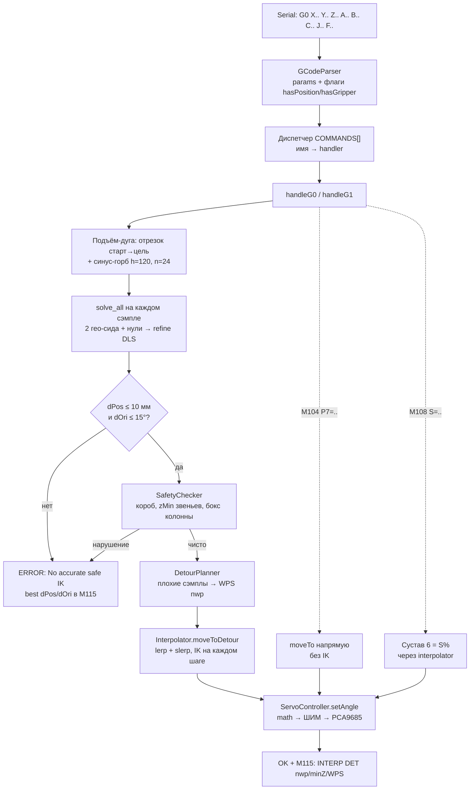
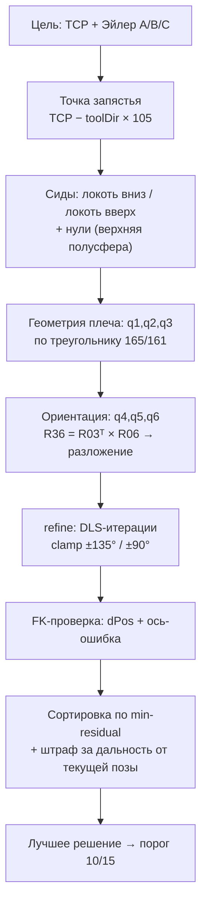

# Как работает прошивка 6DOF — блок-схемы

Рамка: `+X` вперёд, `+Y` влево, `+Z` вверх. Стол = XY (`z=0`).
Порог годности IK: **10 мм / 15°**. Палец захвата 105 мм.

## 1. Тракт команды G0 (декарт)

Параллельно крутится задача дисплея: TCP XYZ + Roll/Pitch/Yaw, ABS над PCA,
последняя команда в статус-баре. Диагностика — всегда `M115`.

## 2. Ядро IK: solve_all + refine

## 3. Отказ — это штатно

Неточного решения НЕТ в прошивке специально: лучше честный
`ERROR` + цифры в M115, чем прыжок в мусор. Частые причины:

- точка слишком близко к телу (локоть складывается за ±135°);
- середина дуги проходит через бокс колонны `[-65,65]²×[0,180]`;
- ориентация по умолчанию `+X (90,0,90)` не вытягивается — задать A/B/C явно.
