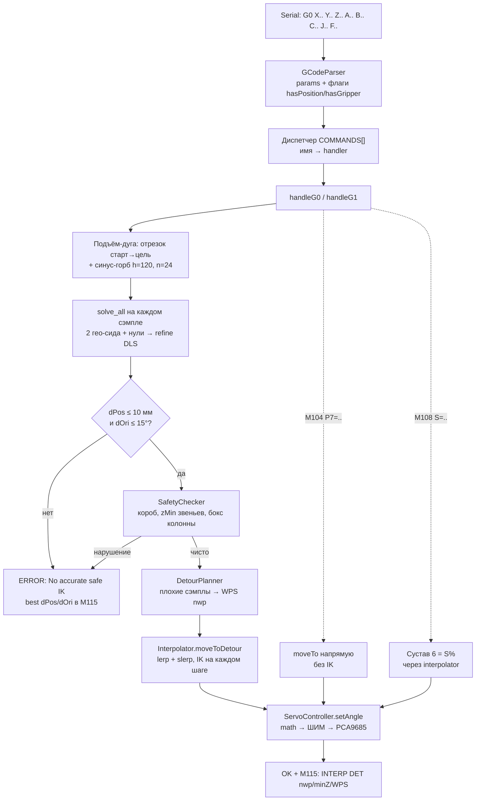
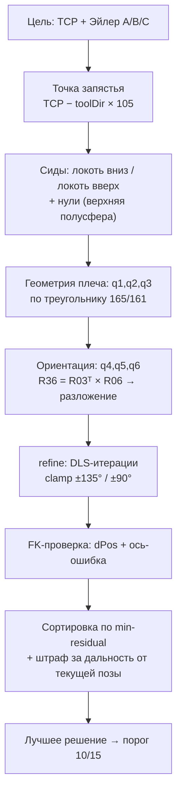

# Как работает прошивка 6DOF — блок-схемы

Рамка: `+X` вперёд, `+Y` влево, `+Z` вверх. Стол = XY (`z=0`).
Порог годности IK: **10 мм / 15°**. Палец захвата 105 мм.

## 1. Тракт команды G0 (декарт)

Параллельно крутится задача дисплея: TCP XYZ + Roll/Pitch/Yaw, ABS над PCA,
последняя команда в статус-баре. Диагностика — всегда `M115`.

## 2. Ядро IK: solve_all + refine

## 3. Отказ — это штатно

Неточного решения НЕТ в прошивке специально: лучше честный
`ERROR` + цифры в M115, чем прыжок в мусор. Частые причины:

- точка слишком близко к телу (локоть складывается за ±135°);
- середина дуги проходит через бокс колонны `[-65,65]²×[0,180]`;
- ориентация по умолчанию `+X (90,0,90)` не вытягивается — задать A/B/C явно.

## 4. Блендинг G1 (флаг Q1, без останова на стыке)

Одиночный `G1` тормозит в конце (`easeInOut` → 0). Для непрерывного
движения (круг из 24 точек) все точки кроме последней шлются с `Q1`:
отрезок не тормозит в конце, следующий стартует с ходу (трапеция
с косинусными рампами 15%, стык C1-непрерывен по скорости).

Правила:

- `G1 ... Q1` = «в конце не останавливаться»; без Q — стоп как раньше.
- Первый отрезок цепочки — только из близкой позы: декартов трекинг
  не стартует через reconfig >45°/шаг (сложенный парк в 70–200° от
  любого сида — `ik-lost` на первом шаге). Вход — joint-путём
  (`G28 H1` → `G28`, штатный путь каждого boot), дальше декарт.
- Стартовый `solveAll` + диагностика сидов пропускаются только внутри
  цепочки (прошлый `G1(Q1)` доехал). Первый отрезок валидируется полностью.
- Оценка времени отрезка в цепочке — урезанным бюджетом (5 ит., только
  для темпа): полная оценка стоит ~0.2с счёта с удержанной позой и
  убивала бы блендинг. На точность не влияет — движет трекинг (25 ит.).
- Честность та же: safety каждого шага, срыв трекинга >45°, а ворота
  10мм/15° проверяются пост-гейтом после отрезка (`ERROR: chain residual
  too big` + разрыв цепочки). `M112`, `moveTo` (G0/M104/G28/jog) и любой
  отказ цепочку рвут — следующий G1 снова со всеми проверками.
- В метке `CART` (M115) видно `chain` + факт темпа `maxStep/avgStep` мс.
- `M115`-диагностика по точкам с блендингом несовместима (нужна
  устоявшаяся поза): `demo_circle.py` в `log`-режиме Q1 не ставит.

## 5. Пакет M450 (планирование отдельно, исполнение отдельно)

Одиночные `G1` останавливаются на стыках (ease + предвычисление каждой
точки прямо перед движением). Пакет убирает остановки полностью:

- `M450 S1` — открыть: следующие `G1` (только IK) копятся без движения.
  `OK` = «принято и провалидировано» (те же solveAll + ворота 10/15 +
  safety; непрерывность считается от прошлой накопленной точки).
  Отказ точки = `ERROR` + сброс всего пакета. Буфер 32 точки.
- `M450 S0` — закрыть и исполнить всё как одну траекторию: рампы только
  по краям пакета, стыки без останова, каданс ровно 20мс
  (`vTaskDelayUntil`). В конце общий `OK: batch done` / `ERROR`.
- `M450 S2` — сбросить без движения (идемпотентно).
- `G0/M104/G28/M108` при открытом пакете запрещены (`ERROR`),
  чтения (`M105/M114/M115`) — можно. `M112` в любой момент — стоп + сброс.
- В рантайме IK-доводки нет осознанно: replay joint-поз детерминирован,
  перемерять нечего; safety каждой точки оставлена (дешёвая, каданс цел).
  Ворота 10/15 — на планировании каждой точки + таблица плановых
  `dPos/dOri` в M115 (`BATCH: n`).
- Пустой `S0`, повторный `S1`, 33-я точка — честные `ERROR`.
